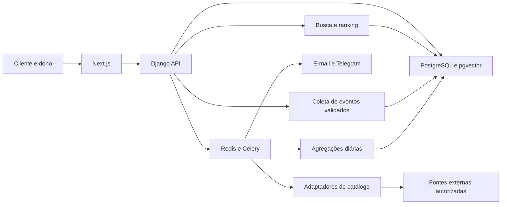

# Plano de implementação — DataFood

Preparado em 04/11/2026, com base na revisão das branches `claude/promocoes-mensageiros-jlkv2u` dos repositórios `DataFoood/front-end` e `DataFoood/back`. Este documento é uma proposta de execução; não representa funcionalidades implementadas, contratação de serviços ou publicação autorizada.

## 1. Resultado esperado e recorte do primeiro lançamento

Entregar uma aplicação que encontre restaurantes reais em uma região, explique suas recomendações, permita divulgar ofertas com consentimento e mostre ao dono quais ações geram interesse e resgates comprovados.

O primeiro lançamento deve atender uma cidade e três perfis: visitante/cliente, dono de restaurante e operador/admin. Marília/SP é uma hipótese inicial, por já aparecer nos dados demo; confirmar a cidade antes da importação real. Manter essa configuração fora do código.

Entregas mínimas:

- Catálogo real com localização, procedência e atualização visíveis; registros demo isolados.
- Busca por texto, filtros e proximidade, com recuperação quando a busca semântica estiver indisponível.
- Campanhas confiáveis por e-mail e Telegram; compartilhamento manual de WhatsApp claramente identificado.
- Painel com períodos comparáveis, ações de contato, resultados de campanhas e resgates confirmados.
- Interface consistente em português, responsiva e acessível.
- Execução local repetível, backup restaurável e recomendação de capacidade baseada em medição.

Ficam para uma etapa posterior: expansão nacional, aplicativo móvel nativo, cobrança de assinaturas, contratação automática de infraestrutura, WhatsApp automatizado e relatórios regionais sem amostra suficiente. As páginas comerciais precisam refletir esse recorte.

## 2. Decisões iniciais e caminhos padrão

| Decisão | Caminho recomendado | Condição para mudar |
| --- | --- | --- |
| Região inicial | Uma cidade e raio configurável | Cobertura e qualidade comprovadas antes de expandir |
| Catálogo próprio | Cadastros de donos e importações autorizadas | Preservar sempre autoria e regras por campo |
| Descoberta externa | Avaliar Google Places em um piloto com orçamento limitado | Aprovar custo e termos atuais antes de uso real |
| Alternativa aberta | Avaliar OSM para cobertura local | Cumprir atribuição/ODbL e verificar adequação à base combinada |
| BI inicial | PostgreSQL, agregações diárias e gráficos no próprio painel | Adotar warehouse apenas com necessidade comprovada |
| Mensageria | Concluir e-mail/Telegram e manter WhatsApp manual | Automação via provedor oficial em projeto próprio |
| Infraestrutura | Local primeiro; expansão de serviços sem dois bancos graváveis independentes | Mover para banco compartilhado somente se latência/custo justificarem |

Não escolher um provedor apenas pelo preço por chamada. Comparar cobertura real da cidade, campos úteis, atualização, condições de exibição, retenção, atribuição, geração de embeddings e custo mensal esperado. Chave, faturamento e orçamento são pré-requisitos do piloto pago, não do restante do desenvolvimento.

## 3. Arquitetura proposta

Preservar Next.js, Django/DRF, PostgreSQL/pgvector, Redis, Celery e shinzou. Evitar uma reescrita ou novos serviços sem necessidade.

Ingestão, atualização de catálogo e envio são trabalhos assíncronos. A busca deve responder a partir de dados permitidos e já preparados; não importar um catálogo inteiro durante uma requisição do usuário. Consultas externas sob demanda, quando utilizadas, devem ter timeout, limite de custo e apresentação compatível com o contrato do provedor.

## 4. Etapa 0 — Consolidar a entrega existente

1. Confirmar os SHAs atuais das branches remotas e comparar com a versão revisada: front `73bc57a`, back `4a06031`.
2. Preservar as melhorias já existentes: capitalização, cookies HttpOnly, isolamento de contas, paginação, conversas e promoções.
3. Transformar os quatro testes de reprodução da revisão em regressões permanentes, ajustando-os ao contrato final escolhido.
4. Inventariar a configuração real de produção sem expor segredos: origem dos dados, serviços de embeddings, canais habilitados, workers, beat e backups. A revisão local não comprovou esses pontos em produção.
5. Preparar migrações compatíveis com a versão anterior e uma estratégia de recuperação de dados; rollback de código não deve depender de apagar novas tabelas.

Aceite: baseline reproduzível; diferenças entre main, branch e produção registradas; nenhuma funcionalidade anunciada como validada apenas porque existe um mock.

## 5. Etapa 1 — Tornar as promoções confiáveis

### Validade, consentimento e estados

- Validar a data de envio contra a validade ao agendar, editar e executar. Definir validade no fuso do restaurante; inicialmente usar `America/Sao_Paulo`.
- Ao retornar de uma interrupção local, expirar campanhas fora da janela em vez de enviá-las atrasadas. Definir explicitamente a tolerância de atraso para as ainda válidas.
- Revalidar consentimento, vínculo do canal e elegibilidade antes de tentar o envio. Um descadastro posterior à criação da campanha precisa impedir tentativas ainda não executadas.
- Separar estados da campanha e da entrega. Campanha pode estar em rascunho, agendada, processando, concluída, parcialmente falha, falha, cancelada ou expirada. Uma chamada aceita pelo provedor não significa leitura ou compra.
- Preservar transições e motivos para auditoria. Não transformar erro transitório em sucesso definitivo.

### Concorrência e recuperação

- Criar reserva transacional de cota por usuário, compartilhada entre campanhas e canais. Para preservar a regra atual de 24 horas móveis, serializar a decisão por usuário e contar reservas ativas mais campanhas aceitas nessa janela; não substituir silenciosamente por um contador de dia calendário.
- Criar uma única intenção de entrega por campanha/usuário/canal, com prazo da reserva, tentativas, próxima tentativa e último erro sanitizado.
- Usar outbox transacional para não perder o disparo se o commit do banco ocorrer e a publicação na fila falhar.
- Não segurar transações enquanto chama SMTP ou Bot API. Reservar, confirmar a transação, chamar o provedor e persistir o resultado.
- Repetir apenas erros recuperáveis, com backoff, jitter, máximo de tentativas e respeito ao `retry_after`. Nunca agendar tentativa além da validade.
- Tratar timeout depois da chamada como resultado potencialmente desconhecido. Não prometer exactly-once em SMTP/Telegram; definir a política entre possível duplicação e possível perda e exibir essa limitação ao operador.
- Monitorar filas, entregas travadas, outbox pendente e campanhas com falha total. O reprocessamento deve ser explícito e rastreável.

Aceite: ofertas vencidas não saem; dois workers não excedem a cota; descadastro bloqueia tentativas futuras; queda entre banco e fila não perde o trabalho; falhas não aparecem como entrega comprovada. Exercitar concorrência com conexões de banco separadas, além dos testes unitários.

## 6. Etapa 2 — Construir o catálogo real

### Proveniência e modelo

Criar `RestaurantSource` relacionado ao restaurante, com provedor, ID externo, link da fonte, data de obtenção, última verificação, próxima atualização e metadados de atribuição. Usar unicidade por `(provider, external_id)`; um restaurante pode ter múltiplas fontes.

Definir por provedor e por campo o que pode ser armazenado, por quanto tempo, exibido e usado para indexação. Não colocar automaticamente respostas completas de uma API em JSON permanente ou em logs. Quando o contrato exigir, conservar apenas referência e buscar os detalhes no momento adequado.

Adicionar suporte explícito a registros demo e ao estado de verificação. Registrar procedência das informações fornecidas pelo dono. Separar avaliação externa, com escala/fonte/data, da avaliação DataFood; não combinar médias como se fossem a mesma amostra.

### Ingestão

- Interface de adaptadores com descoberta, detalhes, normalização e regras de persistência. Um adaptador implementado antes de generalizar os demais.
- `ImportRun` com área consultada, cursor/checkpoint, totais, falhas e custo estimado; reexecução idempotente.
- Fila com limites por provedor e orçamento interno que bloqueie novas chamadas quando necessário. Alertas de billing complementam esse controle; não presumir que um alerta limita gastos.
- Deduplicar primeiro por referência externa. Similaridade de nome/endereço/coordenadas gera candidatos para revisão; não fundir automaticamente filiais próximas.
- Atualizações externas não sobrescrevem silenciosamente alterações verificadas do dono.
- Implementar reivindicação de restaurante com verificação de titularidade; conhecer um place ID ou telefone não concede acesso ao painel.
- Indexar apenas conteúdo com uso permitido, com hash e versão do modelo. Mudança de dimensão exige migração/reindexação planejada.
- Processo de expiração, remoção e atualização deve alcançar cache e embeddings derivados quando aplicável.

Aceite: importar duas vezes não duplica; alterações têm precedência definida; atribuição aparece onde necessária; nenhuma entidade demo é tratada como verificada; erro/quota de provedor não derruba o catálogo já disponível. A meta quantitativa de cobertura será definida após medir a disponibilidade na cidade escolhida.

## 7. Etapa 3 — Busca que encontra e explica

- Permitir cidade/bairro/endereço informado e geolocalização opcional. Sem permissão, manter o caminho manual.
- Aplicar localização, disponibilidade dos dados e filtros obrigatórios antes do ranking. Usar distância com implementação correta e índices adequados; avaliar PostGIS conforme necessidade e benchmark.
- Exibir distância aproximada, fonte, atualização e limitações dos dados. “Aberto agora” exige horário confiável e fuso correto; ausência de horário não significa aberto.
- Combinar recuperação textual e semântica com proximidade e atributos relevantes. Trabalhar com dados incompletos sem inventar preço, cozinha ou ambiente.
- Na falta do serviço de embeddings, manter busca textual e filtros com indicação clara de degradação.
- Explicar o resultado com atributos reais: cozinha, faixa de preço conhecida, distância e disponibilidade. Substituir “% match” como suposta probabilidade por uma indicação de afinidade contextual até haver calibração validada.
- Não deduzir que todo telefone aceita WhatsApp. Separar telefone de canal de contato confirmado.

Avaliação: criar um conjunto revisado de consultas reais da cidade, incluindo nomes, bairros, orçamento, ocasião e ausência de resultado. Medir cobertura, duplicatas, relevância no top 3/top 5 e latência p95. Usar o simulador de embeddings só para integração; avaliar relevância com modelo real e conteúdo autorizado.

Aceite: filtros não são violados; consultas conhecidas encontram estabelecimentos reais; falha externa tem recuperação útil; teste humano registra a qualidade e os casos sem informação suficiente.

## 8. Etapa 4 — BI orientado a decisões

### Contrato de medição

| Decisão do dono | Métrica necessária | Limite de interpretação |
| --- | --- | --- |
| Estou sendo descoberto? | Impressões de resultados e abertura de detalhe | Definir impression como item realmente exibido, não só retornado pela API |
| Meu cadastro desperta interesse? | Favoritos, abertura de menu e cliques em contato/rota | Clique é intenção; não comprova atendimento ou venda |
| Qual promoção funciona? | Aceitação por canal, falhas, visitas atribuídas e resgates | Comparar janelas e públicos equivalentes |
| O que ajustar no cadastro? | Dados faltantes e desempenho antes/depois | Correlação não prova causalidade |
| Qual o retorno financeiro? | Resgates e valores confirmados | Só calcular receita/ROI quando houver dados suficientes |

Criar `AnalyticsEvent` com identificador de deduplicação, tipo permitido, restaurante, campanha opcional, horário de recebimento e contexto mínimo validado. Não aceitar status de entrega, compra ou resgate como verdade por um evento livre do navegador. Validar limites, propriedade dos recursos, referências e horários; limitar abuso e excluir navegação do próprio dono das métricas de descoberta quando identificável.

Separar medição operacional agregada de rastreamento comportamental. Definir consentimento/base aplicável, retenção e exclusão; não copiar mensagens, dados de contato ou consultas livres para uma tabela de BI por conveniência. Identificadores de sessão, quando usados, precisam de escopo e retenção definidos; não alegar anonimato apenas por remover o nome.

Definir atribuição por campanha e janela antes dos gráficos. Visitas sem identificador verificável permanecem não atribuídas. Links compartilhados podem mostrar clique/visita, mas não entrega de WhatsApp.

### Resgate e apresentação

- Resgate confirmado pelo restaurante com permissão de operador, limite de uso e registro auditável. O cliente não pode marcar sua própria compra como confirmada.
- Agregações diárias idempotentes, no fuso correto, com reprocessamento para atrasos e exclusões.
- Filtros de 7/30/90 dias à medida que existir histórico; comparação com período anterior equivalente, inclusive zeros e falta de dados.
- Gráficos de descoberta, interesse e campanha; segmentação por canal; exportação CSV protegida contra fórmulas; acessibilidade por tabela.
- Mostrar última atualização, cobertura e tamanho da amostra. Não exibir tendência ou “insights do bairro” quando faltarem dados ou houver risco de identificar participantes em grupos pequenos.

Aceite: resultados batem com fixtures de eventos; eventos repetidos não duplicam contagem; um dono não consulta outro; denominadores e períodos são explícitos; receita aparece como indisponível quando não foi medida. Evitar chamar visitas anônimas de pessoas únicas.

## 9. Etapa 5 — Interface e comunicação

Usar a capitalização já corrigida na branch. Preservar nomes próprios, tokens de cor e componentes existentes.

- Revisar hierarquia de títulos, contraste, tamanhos mínimos de leitura, espaçamentos e comportamento móvel. Evitar redesenhar todas as telas sem uma referência visual aprovada.
- Organizar o painel para responder: o que aconteceu, como se compara, o que posso fazer agora.
- Diferenciar estados sem dados, sem resultados, carregando, erro e operação concluída parcialmente.
- Nomear ações com precisão: “Compartilhar no WhatsApp”, “Aceita pelo provedor”, “Resgate confirmado”.
- Marcar fonte externa e registro demo; explicar localização/raio e oferecer correção manual.
- Ajustar a landing e planos para anunciar só capacidades disponíveis. Não manter venda de BI regional/API de demanda sem entrega correspondente.
- Garantir foco visível, navegação por teclado, rótulos, formulários compreensíveis e tabela equivalente aos gráficos.

Aceite: revisão visual em celular e desktop; nomes próprios preservados; fluxo completo com teclado; nenhuma promessa comercial sem funcionalidade real. Testes de interface devem verificar comportamento e nomes acessíveis, sem mascarar regressões com seletores excessivamente permissivos.

## 10. Etapa 6 — Operação local e fins de semana

Primeiro definir quem opera a instalação local e como clientes e mensageiros acessam os links. Uma aplicação só em localhost não oferece páginas públicas utilizáveis pelos destinatários das promoções. Decidir entre endereço público controlado, acesso privado adequado ao piloto ou um ambiente hospedado sempre acessível.

Implantar telemetria operacional: buscas agregadas, requisições, latência p50/p95, erros, tamanho e idade da fila, uso de CPU/RAM, conexões e duração das consultas ao banco. `SearchHistory`, condicionado a consentimento e podado, não é contador confiável da carga integral.

- Medir a máquina local com carga representativa e estabelecer limites observados. Definir SLOs após esse baseline, não inventar capacidade com número fixo de buscas/dia.
- Recomendação de capacidade deve considerar simultaneidade, fila, horários e disponibilidade de histórico. Sem amostra: “Dados insuficientes”.
- Diferenciar gargalo de CPU/embeddings, banco e quota de mensageiro: contratar VPS não resolve limite de provedor.
- Preferir expansão de workers/serviço de embeddings quando for o gargalo e houver acesso seguro aos dados; medir a latência desse desenho.
- Para migração temporária da stack inteira, ter uma única fonte de verdade. No MVP, pausar escritas, transferir, verificar e cortar tráfego; não permitir dois bancos graváveis que depois serão reconciliados por dump.
- Definir liderança única de agendador/polling de Telegram, reconexão e reconstrução da fila a partir do banco/outbox.
- Praticar backup e restauração, medir perda máxima tolerável e tempo de recuperação, incluir mídia e configuração além do banco. Um arquivo de backup existente não prova restauração.
- Registrar custo estimado com componentes incluídos/excluídos: compute, banco, armazenamento, transferência e APIs. Não vender 54 horas de VPS como custo total sem essas parcelas.

Aceite: reinício recupera trabalho válido; restauração testada; migração não perde escritas; ausência de dois pollers ativos; plano claro de retorno e custo acompanhado. Provisionamento automático exige etapa própria depois que a migração manual estiver comprovada.

## 11. Sequência de PRs e dependências

Cada PR deve ser pequeno o suficiente para revisão, com alteração de contrato e migrações explícitas. Os pares de PRs front/back entram em ordem compatível.

| Ordem | Entrega | Dependência |
| --- | --- | --- |
| 1 | Regressões e correção de validade/agendamento | Baseline revisado |
| 2 | Reserva de cota e testes concorrentes | Regra de cota definida |
| 3 | Estados de envio, outbox, tentativas e recuperação | 1–2 |
| 4 | Ajuste de texto/estados do painel de promoções | Contrato do PR 3 |
| 5 | Proveniência, demo, políticas por fonte e deduplicação | Decisão de dados |
| 6 | Adaptador inicial e importação controlada | 5 e acesso à fonte |
| 7 | Localização, busca textual/híbrida e explicações | 5–6 |
| 8 | Contrato e coleta validada de eventos | Definições de BI/privacidade |
| 9 | Resgates, atribuição e agregações | 3 e 8 |
| 10 | Painel BI, comparação e exportação | 8–9 |
| 11 | Revisão visual e alinhamento da landing | Pode começar antes; consolidar após 7 e 10 |
| 12 | Telemetria, benchmark, recuperação e infraestrutura | Carga e fluxo reais disponíveis |
| 13 | Testes integrados, piloto e ajustes finais | Etapas anteriores |

É possível desenvolver esquema de catálogo, contrato de eventos e correções de promoções em frentes independentes; manter pontos de integração acordados para evitar retrabalho. Não iniciar todos os itens simultaneamente.

## 12. Estratégia de testes e evidências

- **Regressão:** preservar as suítes existentes. Na revisão: 240 testes Django, 49 verificações E2E gerais e 16 de promoções passaram; isso não cobre os defeitos adicionais encontrados.
- **Concorrência real:** duas conexões/workers, cota compartilhada, repetição de tarefa e corrida entre cancelar/editar/disparar.
- **Tempo:** virada de dia no fuso, expiração, atraso, reinício após dias desligado, descadastro entre fila e tentativa.
- **Adaptadores:** testes determinísticos com respostas locais e testes contratuais optativos com credencial de teste e orçamento limitado. Não confundir simulação com integração real.
- **Catálogo:** paginação, rate limit, atualização, duplicatas, filiais, remoções e precedência de dados verificados.
- **Busca:** avaliação humana sobre catálogo real, recuperação textual e falha do serviço semântico. Não usar embedding falso para provar relevância.
- **BI:** contagens, deduplicação, atribuição, amostra, fuso, exportação e isolamento por restaurante.
- **E2E:** importar um estabelecimento autorizado; encontrá-lo; favoritar/consentir; criar/agendar campanha; aceitar via canal de teste; visitar; confirmar resgate; conferir BI; descadastrar; verificar bloqueio de nova tentativa.
- **Resiliência:** falha após commit, broker fora, timeout do mensageiro, reinício do worker, restauração e reprocessamento.

Rodar testes que compartilham o cache de throttle sequencialmente ou com configurações isoladas. Canal de teste deve estar restrito a contas controladas; ensaios nunca disparam campanhas para usuários reais inadvertidamente. Guardar logs sanitizados, contagens e comandos com resultado; manter passou/falhou/pulado/não executado distintos.

## 13. Piloto e critérios de lançamento

Usar flags de recurso para catálogo externo, novo ranking, BI e envio por canal. Liberar primeiro para operadores e restaurantes participantes, com volume limitado.

Só considerar o piloto pronto quando:

1. Os três achados da revisão estiverem corrigidos e cobertos por testes.
2. A fonte de catálogo estiver aprovada para os usos implementados e com cobertura conferida na região escolhida.
3. O simulador de embeddings estiver excluído da configuração de produção; a busca com modelo real e a recuperação textual estiverem verificadas.
4. Pelo menos o canal que será anunciado estiver validado com contas controladas, do consentimento ao descadastro.
5. O painel reconciliar resultados com eventos/resgates de referência e não apresentar cliques como vendas.
6. Os links públicos funcionarem para o público do piloto e os registros demo estiverem isolados.
7. Backup, restauração, reinício, alertas e recuperação de filas estiverem ensaiados.
8. Landing, ajuda e configuração refletirem o que efetivamente foi entregue.

O marco final é um piloto útil e observável, não uma promessa de busca nacional ou BI preditivo antes de existir base suficiente.

## 14. Planejamento de esforço

Não fixar prazo total antes do piloto de dados e da definição de capacidade da equipe. Estimar por PR após a etapa 0; registrar incerteza maior em licenciamento/cobertura, canais reais, qualidade do ranking e migração local/nuvem.

Marcos de acompanhamento: **promoções confiáveis → catálogo real e busca → medição confiável e BI → operação recuperável → piloto**. Dependências externas podem impedir um marco sem bloquear as tarefas independentes: enquanto um provedor aguarda acesso, implementar contrato, modelos, validações, UI e testes com fixtures claramente identificadas.
